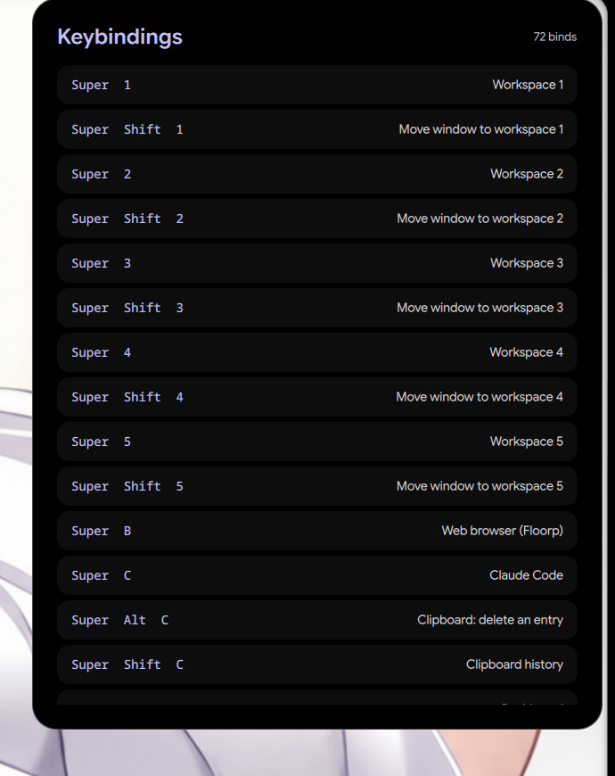

# Keyboard shortcuts — on-screen cheat-sheet

A Quickshell widget (`qs -c keybinds`) that lists every Hyprland keybinding,
opened with **Super+/** (or the top-right hot corner). On KDE the same widget
reads `kglobalshortcutsrc` instead (`qs -c kde-keybinds`, plus a `yad` fallback
list).

## Install
Desktop Manager → Apps → **Keyboard shortcuts → Install**, or `./install.sh`.
Requires **quickshell**. Deploys both widgets and the toggle commands
(`~/.local/bin/keybinds-toggle.sh` and `keybinds.sh`), then adds the Super+/
binding + autostart to your Hyprland config (marker-guarded, idempotent).

Everything goes under the **session's** `$XDG_CONFIG_HOME`, resolved from the
running compositor rather than from the shell that runs the installer — see
`../../scripts/xdg-session-paths.sh`. `./install.sh --where` prints the
destinations and where each one came from; `./install.sh --check` says whether
the install matches this source *and* is somewhere your session will find it.

If **Super+/** is already bound, the installer says so and adds no bind rather
than opening two cheat-sheets on one keypress — worth knowing, because the
end-4 / ii shell ships its own cheat-sheet on exactly that key. Bind a free key
yourself, or run `~/.local/bin/keybinds-toggle.sh`.

`./uninstall.sh` reverses the wiring and removes the files.
