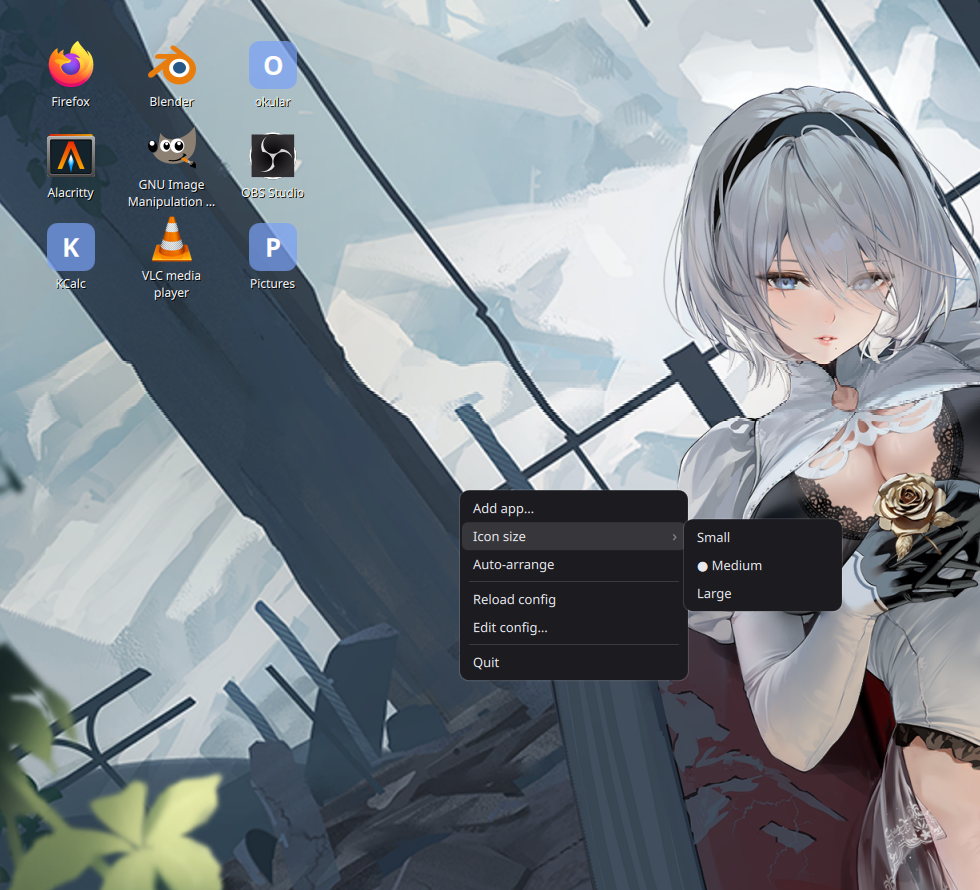

# omarchy-desktop-icons

App icons on your desktop, double-click to open — the thing you miss from
Windows. It sits on the wallpaper, underneath all your windows. It does **not**
replace your bar, your dock, your wallpaper or your theme. Omarchy stays
Omarchy; this just adds icons.



---

## 1. Install it

You need **quickshell**. Open a terminal and run:

```bash
yay -S quickshell
```

If that says "target not found", use the development build instead:

```bash
yay -S quickshell-git
```

Then, from this folder:

```bash
./install.sh
```

That copies everything to `~/.local/share/omarchy-desktop-icons` and puts a
command called `omarchy-desktop-icons` on your `$PATH`.

If the terminal later says `command not found: omarchy-desktop-icons`, add this
line to the bottom of `~/.bashrc` and open a new terminal:

```bash
export PATH="$HOME/.local/bin:$PATH"
```

## 2. Try it

```bash
omarchy-desktop-icons
```

Leave that terminal open for now. Switch to an empty workspace (SUPER + a
number you aren't using) and you should see a few icons in the top-left corner,
picked from the apps you already have installed.

- **Double-click** an icon to open the app.
- **Single click** just selects it.
- **Drag** an icon to move it. It snaps to the grid and remembers where you put it.
- **Right-click** the wallpaper or an icon for the menu.

To stop it, press `Ctrl+C` in that terminal, or run `omarchy-desktop-icons stop`
from another one.

## 3. Add your first icon

Right-click anywhere on the empty wallpaper → **Add app…** → start typing the
name of the app → press Enter. The icon appears where you right-clicked.

You can also **drag a `.desktop` file** (or any file or folder) from your file
manager onto the desktop and it becomes an icon.

To change one: right-click the icon → **Rename…**, or **Remove "…"**.
To make them bigger: right-click → **Icon size → Large**.

## 4. Start it automatically at login

Pick **one** of these two. On a normal Omarchy install, **A is the one you want**.

### A. Hyprland autostart — recommended

Omarchy has been moving from the old `.conf` files to Lua. Check which you have:

```bash
ls ~/.config/hypr/
```

**If you see `autostart.lua`** (current Omarchy), add this line to
`~/.config/hypr/autostart.lua`:

```lua
o.launch_on_start("omarchy-desktop-icons")
```

**If you see `hyprland.conf` and no `autostart.lua`** (older Omarchy, and what
the published manual still describes), add this line to
`~/.config/hypr/hyprland.conf`:

```ini
exec-once = omarchy-desktop-icons
```

Then log out and back in.

### B. systemd user service

`install.sh` already copied the unit into place. Turn it on with:

```bash
systemctl --user enable --now omarchy-desktop-icons
```

This one restarts the app automatically if it ever crashes, which is nice. The
catch: it only works if your session actually reaches
`graphical-session.target` — that happens if Hyprland is started through
**uwsm**, and does not happen on a plain `Hyprland` launch. If you enable it and
nothing appears after a reboot, use option A instead and turn this one off:

```bash
systemctl --user disable --now omarchy-desktop-icons
```

## 5. Optional: SUPER+I to bring the icons to the front

Because Omarchy tiles windows full-screen, the desktop is usually covered. You
can bind a key that puts the same grid on top of everything with a dimmed
background, like the Windows Start screen. Press it again (or Escape, or click
away) to dismiss it.

**First check the key is free on your machine:**

```bash
omarchy menu keybindings --print | grep -i ' I$'
# or:
hyprctl binds -j | jq -r '.[] | select((.key|ascii_downcase)=="i") | "\(.modmask) \(.key) -> \(.dispatcher) \(.arg)"'
```

Omarchy 3 uses SUPER+CTRL+I but leaves plain SUPER+I free. If the command above
prints nothing for a bare SUPER, you're fine.

**Lua config** (`~/.config/hypr/bindings.lua`):

```lua
o.bind("SUPER + I", "Desktop icons", "omarchy-desktop-icons toggle")
```

**Older `.conf`** (`~/.config/hypr/bindings.conf`):

```ini
bind = SUPER, I, exec, omarchy-desktop-icons toggle
```

This talks to the program that is already running — it never starts a second
copy.

## 6. Remove it all again

```bash
cd ~/.local/share/omarchy-desktop-icons && ./uninstall.sh
```

Add `--purge` if you also want your icon layout deleted. Then delete the
autostart line you added in step 4.

---

## Running it on end-4 / illogical-impulse (not Omarchy)

v1 was developed and tested on **Hyprland 0.56.2 + end-4 illogical-impulse**,
so this path is the *more* tested of the two. Four differences:

**Run it without installing anything.** From a checkout:

```bash
qs -p /path/to/omarchy-desktop-icons          # start
qs -p /path/to/omarchy-desktop-icons kill     # stop
qs list --all                                 # confirm your own shell is untouched
```

Quickshell identifies an instance by its **config path**, so this is a separate
instance from your end-4 shell. Never run a bare `qs kill` — that takes your
bar, dock and wallpaper with it.

**The first column lands under your bar.** end-4 reserves roughly the left
506px. In `~/.config/omarchy-desktop-icons/config.json`, set
`geometry.margins.left` to about `560`, or set `geometry.anchor` to
`"top-right"`.

**`SUPER+I` is already end-4's Settings app.** Use `SUPER+SHIFT+I` for the
overlay bind in step 5.

**The bottom layer is shared, and it works.** end-4 paints its wallpaper as a
`bottom`-layer surface (`quickshell:background`) covering the whole screen;
there is no separate wallpaper client. The grid renders above it and receives
its clicks — verified live, not assumed — because within a layer Hyprland
stacks by creation order and the grid starts later. Start your shell first, the
grid second. Two full-screen surfaces coexisting on `bottom`, grid second:

```
$ hyprctl layers
	Layer level 1 (bottom):
		Layer ...da80: xywh: 0 0 3440 1440, namespace: quickshell:background,  pid: 5623
		Layer ...0010: xywh: 0 0 3440 1440, namespace: omarchy-desktop-icons,  pid: 40232
```

**`hyprctl dispatch` takes Lua here, not the classic syntax.** On a Lua-configured
Hyprland (end-4, and current Omarchy master) `hyprctl dispatch exec foo` fails
with `')' expected near ...`; it wants `hyprctl dispatch 'hl.dsp.exec_cmd("foo")'`.
`Apps.qml` tries the classic form first and falls back to the Lua one, so
`Open on new workspace` works on both. Worth knowing if you script against it.

## The config file

Everything lives in one hand-editable file:

```
~/.config/omarchy-desktop-icons/config.json
```

Right-click → **Edit config…** opens it in your editor; right-click →
**Reload config** picks up the changes. (It's JSON rather than TOML because QML
reads and writes JSON natively — a TOML parser would have been more code than
the whole rest of the app. Writes are atomic, so a crash can't leave you with
half a file.)

```jsonc
{
  "geometry": {
    "anchor": "top-left",     // top-left | top-right | bottom-left | bottom-right
    "margins": { "top": 24, "left": 24, "right": 24, "bottom": 24 },
    "columns": 0,             // 0 = as many as fit
    "screen": ""              // "" = first monitor, or a name like "DP-1"
  },
  "behaviour": {
    "icon_size": "medium",    // small | medium | large
    "activate": "double",     // double | single
    "label_position": "below" // below | none
  },
  "items": [
    // An installed app. Name, icon and command all come from the .desktop
    // entry, so the icon follows whatever icon theme Omarchy is using.
    { "label": "", "desktop_id": "firefox.desktop", "exec": "", "icon": "", "cell": [0, 0] },

    // Anything else: your own command, your own icon name or a path to a file.
    { "label": "My notes", "desktop_id": "", "exec": "xdg-open ~/Documents/notes.md",
      "icon": "text-x-generic", "cell": [0, 1] }
  ]
}
```

`cell` is `[column, row]` counted from the anchored corner. `label` left empty
means "use the app's own name".

## Other things it does

- **Middle-click** an icon to open it on a fresh, empty workspace.
- Colours for the menus follow your desktop theme, trying three sources in
  order and stopping at the first that exists:

  | # | Source | Gives |
  | --- | --- | --- |
  | 1 | `~/.config/omarchy/current/theme` | `light.mode` → light/dark, `col.active_border` from `hyprland.conf` → accent |
  | 2 | `~/.local/state/quickshell/user/generated/material_colors.scss` (end-4) | `$darkmode`, `$primary`, `$surfaceContainer`, `$onSurface` |
  | 3 | built-in defaults | dark, accent `#7aa2f7` |

  Icon *labels* deliberately ignore all of this — they are always white on a
  soft shadow, because they sit on your wallpaper, not on the UI.
- Icons that your icon theme doesn't have fall back to a coloured tile with the
  app's first letter, rather than a broken-image square.

## If something goes wrong

| Symptom | Fix |
| --- | --- |
| `command not found` | See the `$PATH` note in step 1. |
| Nothing appears | You're probably looking at a workspace with a window on it. Switch to an empty one, or set up SUPER+I (step 5). |
| Icons appear but clicks do nothing | Something else is sitting on the wallpaper layer. See "Known limitations". |
| An icon is blank with a letter in it | Your icon theme has no icon for that app. Set `"icon"` yourself in the config. |
| It won't start | Run `omarchy-desktop-icons` in a terminal and read the error. |

## Known limitations

- **One monitor.** The grid is drawn on one screen (`geometry.screen`, default:
  the first one). Showing the same icons on every monitor would be confusing,
  and per-monitor layouts aren't in this version.
- **Another wallpaper-layer app shares the layer.** The grid lives on the
  `bottom` layer-shell layer. Stock Omarchy puts nothing there, so it's yours.
  Some setups (notably the end-4/illogical-impulse dotfiles) draw their
  wallpaper there too — in practice that works, see below, but a wallpaper
  client started *after* the grid would end up on top of it and swallow clicks.
  Start the grid last.
- **Escape and arrow keys only work in the right-click menu**, which gets its
  own surface for exactly that reason — Hyprland never gives keyboard focus to
  the wallpaper layer.
- `Open on new workspace` needs `hyprctl`, so it's Hyprland-only. Everything
  else works on any wlroots compositor with layer-shell.

## What has actually been tested

Everything below was driven on a live **Hyprland 0.56.2 + end-4
illogical-impulse** desktop (3440x1440). **No part of this has run on a real
Omarchy box yet** — Omarchy-specific behaviour is coded defensively and
fixture-tested, but Miya is the first person to exercise it for real.

**Verified live:** grid on the shared `bottom` layer above end-4's wallpaper,
including pointer routing; double-click launch (detached — survives the shell
dying); single-click select; drag-to-reposition with grid snap and persistence;
both context menus and the icon-size submenu; Escape and click-away dismissal;
the searchable `Add app…` picker; rename and remove; live icon resizing; atomic
config writes and `Reload config`; the overlay mode over IPC; middle-click to a
new workspace.

**Verified against fixtures, not a real box:** the theme chain above. All three
tiers were exercised — tier 1 against synthetic Omarchy theme directories (dark
and light), tier 2 against a real end-4 `material_colors.scss`, tier 3 with
both absent — and tier 1 correctly wins when both are present. The Omarchy
fixtures match the documented `light.mode` / `col.active_border` convention, but
a genuine Omarchy theme may still surprise it.

**Not verified at all:** *drag-and-drop to add an icon*. The `DropArea` is
written and reviewed but no Wayland drag source was available to script against
it, so dragging a `.desktop` file from a file manager onto the grid is the one
feature you should expect to find broken. Please report it if it is.

## For the curious: how it's built

| File | What it does |
| --- | --- |
| `shell.qml` | The two surfaces (desktop + overlay), the menu contents, the IPC handler |
| `IconGrid.qml` | Cell layout, selection, drag-to-move, drop-to-add |
| `DesktopIcon.qml` | One icon: image, label, mouse handling |
| `ContextMenu.qml` | The right-click menu, on its own overlay surface |
| `AppPicker.qml` | The searchable "Add app…" list |
| `TextPrompt.qml` | The "Rename…" box |
| `Config.qml` | Reads/writes `config.json` |
| `Apps.qml` | `.desktop` lookup, icon resolution, launching |
| `Theme.qml` | Omarchy / end-4 colour detection |

Run it straight from a source checkout without installing:

```bash
qs -p /path/to/omarchy-desktop-icons
```
