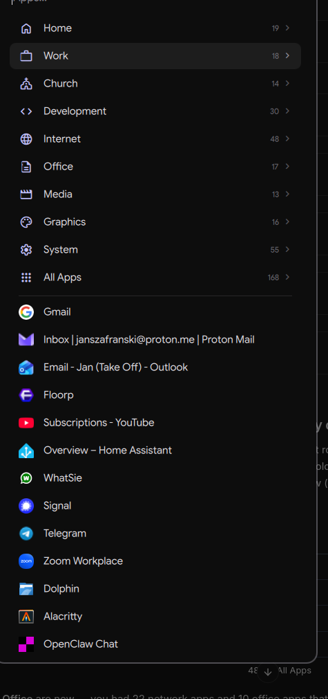

# omarchy-launcher — categorised app launcher

An Omarchy-style categorised application launcher for Caelestia / Hyprland: a
centred, **narrow portrait popup** that opens on **Favourites**. Following
Omarchy's root-menu pattern, the categories are the first rows of the one list —
folders with a count and a chevron — and under a hairline come the apps of the
default category. Open a folder and its apps replace the rows under the same
search line; walk back out and you land on the folder you came from.

Built by **Coding Colin** (Paperclip agent) for this desktop.

## Install
Desktop Manager → Apps → **App launcher → Install**, or `./install.sh`.
Requires **quickshell**. Deploys the launcher (`qs -c omarchy-launcher`), the
`omarchy-launcher` wrapper, and `categories.json`, then adds the **Super+Space**
binding + login autostart to your Hyprland config (marker-guarded, idempotent).
An existing `categories.json` is never overwritten.

Everything goes under the **session's** `$XDG_CONFIG_HOME`, resolved from the
running compositor rather than from the shell that runs the installer — see
`../../scripts/xdg-session-paths.sh`. `./install.sh --where` prints the
destinations and where each one came from; `./install.sh --check` says whether
the install matches this source *and* is somewhere your session will find it.

If **Super+Space** is already bound by your config, the installer says so and
adds no bind rather than giving you two launchers on one keypress. Bind a free
key yourself (e.g. in `custom/keybinds.lua` on end-4 / ii layouts), or replace
the existing bind.

`./uninstall.sh` reverses the wiring and removes the files (your
`categories.json` is kept).

## Keys

| Key | Action |
| --- | --- |
| `Super + Space` | open / close (primary) |
| type | search the current level |
| `↑` `↓` / `PgUp` `PgDn` | move the selection |
| `Enter` | launch app — or, on a folder row, open that category |
| `→` | open the folder under the selection |
| `←` / `Backspace` (empty search) | walk back out to root |
| `Tab` / `Shift+Tab` | next / previous category |
| `Alt + 1…9` | open the Nth folder from anywhere |
| `Esc` | clear search → back to root → close |
| click outside | close |

## App List Config window

You don't have to hand-edit JSON. Colin added an in-launcher editor, the **App
List Config** window: the pinned `tune`-icon row at the top of the System folder,
or `omarchy-launcher config`. It lets you:

- pick a category on the left and **reorder / add / remove** its apps (add via a
  live "ADD AN APP" search; All Apps is generated, so there's nothing to edit
  there);
- **add, rename, re-icon and delete the categories themselves** — *New category*
  (`Ctrl + N`) under the column, the name in the middle header is the rename
  field, the button beside it picks the folder icon, and *Delete* takes two
  clicks. Deleting the opening view or the folder holding the App List Config row
  re-points both at a surviving category rather than stranding them;
- tune the **Highlight** (selection pill) and **Faint outline** (card border) —
  each has a source (text / accent / outline / surface / **custom** `#rrggbb`)
  plus a strength/opacity slider. Every source but Custom is read live from
  Caelestia's scheme, so a wallpaper recolour still drives the theme.

**Save** writes `$XDG_CONFIG_HOME/omarchy-launcher/categories.json` **and**
`appearance.json` (a new file — delete it to fall back to defaults). Both are
watched, so changes apply on the next open, no restart.

## Categories

Everything lives in `$XDG_CONFIG_HOME/omarchy-launcher/categories.json`
(`omarchy-launcher edit` opens it, or use the App List Config window above). The
file is watched — save it and the next open picks the change up, no restart. See
**[APP-README.md](APP-README.md)** for the full category schema, XDG
auto-population, and design notes.

## Utilities folder

To keep the list from sprawling, small single-purpose tools are gathered in a
**Utilities** category rather than scattered across Media/System. **Mic Fixer**
(both builds) and the KDE **Keybinds** entries live there, and Mic Fixer is
`exclude`d from Media so it doesn't also auto-appear via its `AudioVideo` tag.
Add more here the same way — a `utilities` entry in `categories.json`, listed
apps by desktop id, and an `exclude` in any auto-filled category that would
otherwise pull them back in.

## Files

Destinations are the session's, not a hardcoded `~/.config` — run
`./install.sh --where` to see where they resolve on your machine.

- `omarchy-launcher` → `~/.local/bin/` — the wrapper you bind to a key (toggle / open / close / restart / edit / daemon)
- `shell.qml` → `$XDG_CONFIG_HOME/quickshell/omarchy-launcher/` — the Quickshell UI
- `categories.json` → `$XDG_CONFIG_HOME/omarchy-launcher/` — category + favourites definitions

The wrapper and `shell.qml` resolve that config root the *same* way
(`$XDG_CONFIG_HOME`, else `$HOME/.config`). They once disagreed, which meant
`omarchy-launcher edit` opened a different file from the one the panel read —
`./install.sh --check` now fails if they ever drift apart again.
