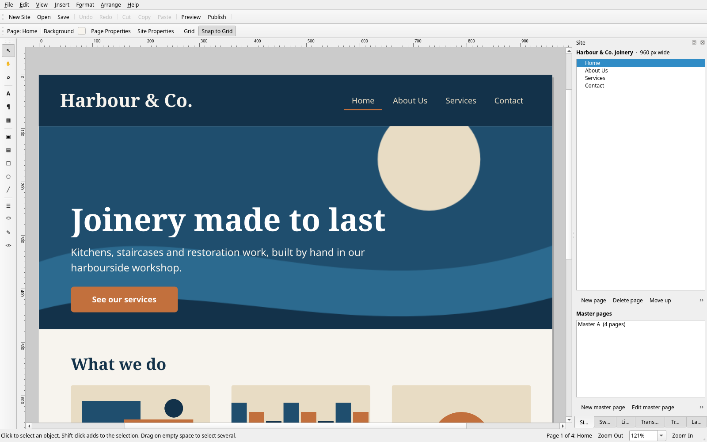

# just a... WEBcreator

A desktop website designer for Linux. Lay pages out freely, put the header and
the menu on a master page so every page shares them, preview in your browser,
and publish plain HTML to a folder you can upload anywhere. It follows your
desktop theme — Plasma colours, accent, fonts and icons.

<p align="center"></p>

The first of the **just a... HANDFUL of apps** — see the section of that name in
the [repository README](../../README.md#just-a-handful-of-apps).

> **Its home is now its own repository**:
> [janszafranski/just-a-collection-of-apps](https://github.com/janszafranski/just-a-collection-of-apps),
> with a site at
> [janszafranski.github.io/just-a-collection-of-apps](https://janszafranski.github.io/just-a-collection-of-apps/).
> That is where **Help ▸ Check for Updates…** reads from, and where the app is
> developed. The copy here is kept in step so the Desktop Manager GUI can still
> install it; edit it there, not here.

## Install

From the Desktop Manager GUI: **Apps ▸ just a… HANDFUL of apps ▸ Install**.
Or directly:

```
sudo pacman -S --needed pyside6 python-beautifulsoup4 qt6-webengine
./install.sh
```

Then open **just a... WEBcreator** from the application menu, or run
`webcreator`. `./uninstall.sh` takes it off again; `--purge` also drops its
saved settings. Neither touches a site you made.

- `pyside6` is required. Use the distro package rather than pip, or the app
  will not pick up your desktop theme.
- `python-beautifulsoup4` is only needed for **File ▸ Import Website Folder…**
- `qt6-webengine` makes an imported page match the original layout exactly;
  without it, imports use a simpler flowing layout.

## What it does

| | |
|---|---|
| **New site** | From any of **92 templates** — three of its own and 89 following the page trees Serif WebPlus X8 shipped — or empty, through the Startup Assistant |
| **Pages** | Add, delete, reorder, nest — the Site tab draws the tree to whatever depth it has |
| **Master pages** | Create, edit, and assign per page, so headers and menus are written once |
| **Objects** | Text, pictures, shapes, buttons, navigation bars, tables, embedded HTML — drag, resize, rotate, align |
| **Import** | **File ▸ Import Website Folder…** reads a folder of HTML back into an editable site |
| **Open a WebPlus site** | **File ▸ Open WebPlus Site…** (`Ctrl+Shift+O`) opens a Serif WebPlus `.wpp` — see below |
| **Publish** | Plain HTML + assets into a folder, previewable in your browser first |
| **Saves as** | `.webc`, a single file, registered as a file type so double-clicking one opens it |

## Opening a Serif WebPlus site

`.wpp` publications made in Serif WebPlus open here and are editable: pages,
master pages, the site structure tree, and every object on every page. The
reading is not done by this app — it is done by `serif.webplus` in the
[Serif-for-Linux](https://github.com/janszafranski) checkout, which the app
finds on its own (`~/src/serif-linux`, `~/Documents/Development/serif-linux`, or
wherever `~/.local/bin/webwriter` points) and asks about once if it has moved.
Without that checkout every other feature still works; only this command asks
where to look.

**Your original is never written to.** A `.wpp` is opened read-only and this app
has no way to write Serif's format: the site arrives with no path, so **Save**
goes to **Save As** and a `.webc` file.

What does not come across is listed in the dialog rather than left to be found —
linked (not embedded) pictures, formats nothing on Linux opens, site-search
widgets. An object with nothing to embed keeps its size and position as an empty
placeholder, so the hole is visible and can be filled.

## Updates

**Help ▸ Check for Updates…** reads this file's copy of `webcreator.py` from
GitHub — repository, branch and path are in **Help ▸ Update Settings…**, and the
dialog shows the exact URL it will use. If the copy there has a higher
`VERSION`, a banner appears on the Startup Assistant and a button in the
toolbar; installing keeps the old version as `webcreator.py.bak` and offers to
restart.

To release one: raise `VERSION` in `webcreator.py`, commit, push to `master`
(this repository's default branch — the URL above is read from exactly there).

Because the app can replace its own installed file, the installed copy can drift
from this one without anything here being edited.
[`scripts/check-webcreator-sync.sh`](../../scripts/check-webcreator-sync.sh)
compares the two and says which way to reconcile.

## Tests

```
cd profiles/webcreator && python3 -m unittest test_webplus_import
```

25 tests, `unittest` rather than pytest because that is what Serif-for-Linux's
suite uses. They run against real publications and **skip, rather than fail**,
on a machine that does not have them or the reader checkout — so they are
honest on someone else's computer and strict on Jan's.

## Files

| File | What it is |
|---|---|
| `webcreator.py` | The whole app |
| `install.sh` / `uninstall.sh` | Install or remove for the current user |
| `webcreator.desktop` | Application menu entry |
| `webcreator-mime.xml` | Registers `.webc` site files |
| `test_webplus_import.py` | The WebPlus-import tests |
